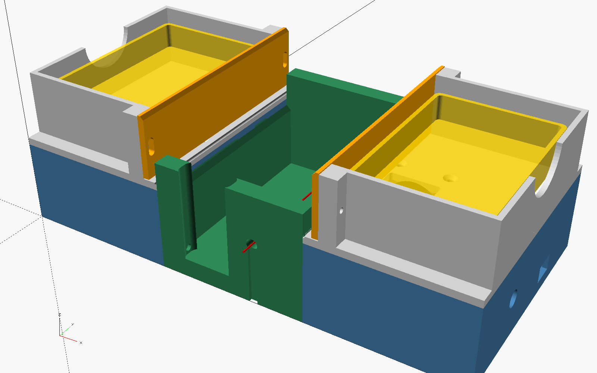

# Arduino Poker-Kartenmischer

Ein automatischer 2-Schacht-Kartenmischer ("Riffle-Shuffler") mit Arduino, zwei
N20-Getriebemotoren und 3D-gedrucktem Gehäuse. Das Deck wird halbiert, links und
rechts eingelegt, und die Maschine lässt die Karten in zufälliger Reihenfolge
einzeln in das mittlere Fach fallen. So funktioniert auch ein echter Riffle-Shuffle.



```
   Schacht LINKS             Ausgabefach            Schacht RECHTS
 ┌──────────────┐┃        ┌──────────────┐        ┃┌──────────────┐
 │  Gewicht     │┃ Gate   │              │   Gate ┃│     Gewicht  │
 │ ▓▓▓▓▓▓▓▓▓▓▓▓ │┃        │   ↓ Karten ↓ │        ┃│ ▓▓▓▓▓▓▓▓▓▓▓▓ │
 │ ════════════ │┃ ═══►   │ - - - - - - -│ ◄═══   ┃│ ════════════ │
 └──────(O)─────┘  Spalt  │  Lichtschr.  │  Spalt  └─────(O)──────┘
        Reibrad           │ ▬▬▬▬▬▬▬▬▬▬▬▬ │          Reibrad
        (N20)             └──────────────┘          (N20)
```

---

## 1. Funktionsprinzip

1. Unter jedem Schacht sitzt ein **Gummi-Reibrad** (N20-Motor), das etwa 1 mm über
   den Boden ragt. Ein **Gewicht** drückt den Stapel auf das Rad.
2. Das Rad schiebt immer die **unterste Karte** durch einen schmalen Spalt unter der
   **Gate-Platte**. Der Spalt ist so eingestellt, dass nur **eine** Karte durchpasst.
3. Die Karte kippt über die Abbruchkante und fällt ins **Ausgabefach**.
4. Dabei unterbricht sie eine **IR-Lichtschranke**. Der Arduino bremst den Motor
   sofort, zählt die Karte und entscheidet zufällig, von welcher Seite die nächste
   Karte kommt.
5. Die Zufallsentscheidung folgt dem **Gilbert-Shannon-Reeds-Modell** (dem
   mathematischen Modell eines echten Riffle-Shuffles):
   `P(links) = Karten_links / (Karten_links + Karten_rechts)`.
6. Kommt nach mehreren Versuchen keine Karte mehr, gilt der Schacht als leer. Die
   restlichen Karten kommen dann von der anderen Seite.

**Empfehlung:** 3 bis 4 Durchgänge. Dazu den Stapel aus dem Ausgabefach nehmen,
wieder teilen, neu einlegen und den Taster drücken. Die LED blinkt nach jedem
Durchgang die Anzahl der bisherigen Durchgänge.

---

## 2. Einkaufsliste (Stückliste)

### Elektronik

| Anz. | Teil | Hinweis | ca. € |
|---:|---|---|---:|
| 1 | **Arduino Nano** (ATmega328P, Klon reicht) | Uno geht auch, passt aber schlechter ins Gehäuse | 5–20 |
| 1 | **TB6612FNG** Motortreiber-Breakout | besser als L298N: kleiner, kaum Spannungsverlust | 3–6 |
| 2 | **N20-Getriebemotor 6 V, 150–300 U/min** | Welle 3 mm mit Abflachung (D-Welle), 10 mm lang | 2×4 |
| 1 | **IR-Lichtschranke 5 mm** (Sender + Empfänger, "IR Break Beam Sensor 5mm") | z. B. Adafruit #2168 oder baugleich. Alternative siehe 5.3 | 3–6 |
| 1 | Taster 16 mm (Einbau, Schließer) | | 1–3 |
| 1 | LED 5 mm + Widerstand 220 Ω | optional, sonst reicht die Onboard-LED | 0,20 |
| 1 | Passiver Piezo-Buzzer | optional | 0,50 |
| 1 | Kippschalter 6 mm (Ein/Aus) | optional | 1 |
| 1 | DC-Einbaubuchse 5,5 × 2,1 mm | | 1 |
| 1 | **Netzteil 5 V / 2 A** mit 5,5 × 2,1-Stecker | alternativ USB-Netzteil über den Nano | 6–10 |
| 1 | Elko 470 µF / 16 V | an VM des Motortreibers | 0,30 |
| 1 | Elko 100 µF / 16 V (oder 10 µF) | an 5 V / GND am Nano | 0,20 |
| – | Lochrasterplatine ca. 5 × 7 cm, Stiftleisten, Dupont-Kabel, Litze | | 3 |

### Mechanik

| Anz. | Teil | Hinweis |
|---:|---|---|
| 4 | **O-Ring 22 × 3 mm NBR** (Innen-Ø × Schnurstärke) | 2 pro Reibrad. Alternativ Gummiband oder Fahrradschlauch-Streifen |
| 4 | M3 × 12 Senkkopf | Motorhalter → Schacht-Boden |
| 4 | M3 × 10 Zylinderkopf + U-Scheibe | Gate-Platten (selbstschneidend in die Säulen) |
| 4 | M3 × 25 Zylinderkopf | Unterbau ↔ Ausgabefach |
| 8 | M3-Muttern | 4 im Motorhalter, 4 im Ausgabefach |
| 2 | M3 × 6 Madenschraube (oder M3 × 6) | klemmt den Motor im Halter von unten |
| 4–8 | Gummifüße (selbstklebend) | rutschfest |
| ca. 150 g | Münzen, M10-Muttern oder Stahlkugeln | Füllung der Andruckgewichte |

### Werkzeug

Lötkolben, Schraubendreher, 3D-Drucker (Bauraum ab 220 × 220 mm reicht), Fühlerlehre
oder Spielkarte zum Einstellen des Spalts, Heißkleber, Sekundenkleber.

**Gesamtkosten:** ca. 40–60 € plus Filament (ca. 350 g).

---

## 3. 3D-Druck-Teile

Alle Teile stehen im parametrischen OpenSCAD-Modell
[`cad/card_shuffler.scad`](cad/card_shuffler.scad). Fertige STL-Dateien liegen in
[`cad/stl/`](cad/stl/).

| Teil | STL | Anz. | Ausrichtung beim Druck | Stützen |
|---|---|---:|---|---|
| Kartenschacht | `tray.stl` | 2 | Boden auf dem Druckbett | nein |
| Gate-Platte | `gate.stl` | 2 | flach liegend | nein |
| Motorhalter | `motor_bracket.stl` | 2 | stehend (Tunnel senkrecht, wie exportiert) | nein |
| Reibrad-Nabe | `wheel.stl` | 2 | flach | nein |
| Unterbau links | `side_box.stl` | 1 | Boden unten | nein |
| Unterbau rechts (Elektronik) | `side_box_elec.stl` | 1 | Boden unten | nein (bei Bedarf Stütze nur für das Taster-Loch) |
| Ausgabefach | `well.stl` | 1 | Boden unten | nein |
| Andruckgewicht | `weight.stl` | 2 | Öffnung oben | nein |

**Empfohlene Druckeinstellungen (PLA oder PETG):**

- Schichthöhe 0,2 mm (Gate und Rad: 0,12–0,16 mm für genauere Kanten)
- 3 Perimeter (Wände), 20–25 % Infill (Gyroid)
- Schacht-Boden: **Ironing (Glätten)** für die Oberseite aktivieren, damit die Karten
  gut gleiten. Alternativ den Boden mit 800er-Schleifpapier glätten oder
  **PTFE-/Teflon-Klebeband** aufkleben (sehr empfehlenswert)
- Gate-Platte: Die **Unterkante** muss gerade und gratfrei sein, sie bestimmt den
  Spalt. Elephant's Foot vermeiden, bei Bedarf leicht entgraten.
- Reibrad: Alternativ komplett aus **TPU (95A)** drucken. Dann sind keine O-Ringe
  nötig, `wheel_r` und `wheel_core_d` im CAD anpassen.

### Teile selbst exportieren / anpassen

```bash
# alle Teile als STL exportieren
cd cad
for p in tray gate motor_bracket wheel side_box side_box_elec well weight; do
  openscad -D "PART=\"$p\"" -o stl/$p.stl card_shuffler.scad
done
```

Wichtige Parameter oben in der `.scad`-Datei:

| Parameter | Standard | Bedeutung |
|---|---|---|
| `card_w`, `card_l` | 63,5 / 88,9 | Kartenformat (Poker). **Bridge-Karten:** `card_w = 57` |
| `gate_gap` | 0,5 mm | Nenn-Spalt unter dem Gate (wird ohnehin per Schlitz justiert) |
| `wheel_r` | 14,5 mm | Rad-Radius inkl. Gummi |
| `wheel_protr` | 1,0 mm | wie weit das Rad über den Boden ragt (0,8–1,5 mm) |
| `wheel_setback` | 12 mm | Abstand Radmitte → Gate |
| `n20_a`, `n20_b` | 12,3 / 10,3 | Tunnel für den N20-Motor. Mit Messschieber nachmessen! |
| `box_h` | 40 mm | Höhe des Unterbaus |
| `beam_z`, `beam_d` | 30 / 5,4 mm | Höhe und Bohrung der Lichtschranke |

---

## 4. Wenn du die Teile lieber selbst in CAD (Fusion 360, Onshape, FreeCAD) konstruierst

Die kritischen Maße, die funktionieren müssen:

1. **Schacht-Innenraum:** 66 × 92 mm (Poker 63,5 × 88,9 + Spiel), Wandhöhe ≥ 25 mm.
   Der Boden muss **eben und glatt** sein.
2. **Gate:** eine verstellbare Platte an der Vorderkante mit senkrechten Langlöchern
   (±2,5 mm). Der Spalt zwischen Unterkante und Boden ist **eine Kartendicke + ca. 0,1 mm**
   (Plastikkarten ca. 0,30–0,32 mm → Spalt ca. 0,40–0,45 mm).
3. **Reibrad:** Ø ca. 29 mm, ragt **ca. 1 mm** durch einen Schlitz (24 × 11 mm) über den
   Boden. Der Kontaktpunkt liegt **ca. 10–15 mm hinter dem Gate**, mittig unter der Karte.
4. **Abbruchkante:** 3–5 mm Boden hinter dem Gate, dann fällt die Karte ca. 20 mm tief.
5. **Ausgabefach:** Innenraum 68 × 94 mm, die Oberkante der Querwände liegt einige mm
   **unter** der Abbruchkante und ist nach innen angefast.
6. **Lichtschranke:** quer (parallel zur langen Kartenseite) durch das Ausgabefach,
   **über** dem vollen Stapel (> 20 mm über dem Fachboden) und **unter** der
   Abbruchkante. Dann muss jede fallende Karte, egal von welcher Seite, den Strahl
   kreuzen. **Ein Sensor genügt für beide Seiten.**
7. **Andruckgewicht:** ca. 60 × 84 mm, 80–150 g, unten glatt.
8. Teile max. ca. 200 × 200 mm, damit sie auf gängige Drucker passen.

---

## 5. Verkabelung

### 5.1 Pinbelegung

| Arduino Nano | Verbunden mit |
|---|---|
| D2 | Lichtschranke Empfänger **Signal** (weiß) |
| D4 | TB6612 **STBY** |
| D5 (PWM) | TB6612 **PWMA** (Motor links) |
| D7 | TB6612 **AIN1** |
| D8 | TB6612 **AIN2** |
| D6 (PWM) | TB6612 **PWMB** (Motor rechts) |
| D9 | TB6612 **BIN1** |
| D10 | TB6612 **BIN2** |
| D11 | Buzzer (+), Buzzer (–) an GND *(optional)* |
| D12 | Taster → GND (interner Pull-up) |
| D13 | LED (+) über 220 Ω → GND *(optional, Onboard-LED ist schon da)* |
| A0 | **nicht anschließen** (Rauschquelle für den Zufallsgenerator) |
| 5V | TB6612 VCC, Lichtschranke Sender + Empfänger (rot) |
| GND | gemeinsame Masse für alles |

### 5.2 Schaltplan

```
 5V-Netzteil ──[DC-Buchse]──[Schalter]──┬───────────────┬──────────────┬──── +5V
                                        │               │              │
                                    470µF ┴         TB6612 VM      Nano 5V-Pin
                                        │           TB6612 VCC     Lichtschranke (rot)
 GND ───────────────────────────────────┴───────────────┴──────────────┴──── GND

            Arduino Nano                    TB6612FNG
           ┌───────────┐                  ┌──────────┐
           │ D4  ──────┼──────────────────┤ STBY     │
           │ D5  ──────┼──────────────────┤ PWMA  AO1├──── Motor LINKS  (+)
           │ D7  ──────┼──────────────────┤ AIN1  AO2├──── Motor LINKS  (–)
           │ D8  ──────┼──────────────────┤ AIN2     │
           │ D6  ──────┼──────────────────┤ PWMB  BO1├──── Motor RECHTS (+)
           │ D9  ──────┼──────────────────┤ BIN1  BO2├──── Motor RECHTS (–)
           │ D10 ──────┼──────────────────┤ BIN2     │
           │           │                  └──────────┘
           │ D2  ──────┼──── Lichtschranke Empfänger (Signal)
           │ D12 ──────┼──── Taster ──── GND
           │ D11 ──────┼──── Buzzer ──── GND
           │ A0  (frei)│
           └───────────┘
```

**Tipps:**
- An jeden N20-Motor direkt an den Kontakten einen **100-nF-Keramikkondensator**
  löten (Entstörung).
- Bei Betrieb über das Netzteil: 5 V an den **5V-Pin** des Nano (nicht an VIN!).
  Zum Programmieren darf USB zusätzlich stecken.
- Läuft ein Motor falsch herum: Motorkabel tauschen **oder** im Code
  `INVERT_LEFT` / `INVERT_RIGHT` auf `true` setzen.

### 5.3 Lichtschranke: Alternative zum Selbstbauen

Statt eines fertigen Break-Beam-Sensors:
- **Sender:** IR-LED 940 nm, 5 mm, mit 150 Ω an 5 V
- **Empfänger:** IR-Fototransistor 5 mm (z. B. SFH 309 FA, BPW 85, L-53P3C).
  Emitter an GND, Kollektor an D2 (interner Pull-up ist aktiv).
- Achtung, die Logik ist hier umgekehrt (Strahl unterbrochen = HIGH). Im Code
  `SENSOR_ACTIVE = HIGH` setzen.

---

## 6. Zusammenbau

1. **Teile drucken** und alle Kanten, auf denen Karten gleiten, entgraten.
2. **Muttern einsetzen:** je 2 M3-Muttern von unten in den Motorhalter, 4 Muttern von
   unten in die Schlitze des Ausgabefachs.
3. **Reibrad:** O-Ringe in die Nuten ziehen. Nabe auf die N20-Welle pressen
   (die D-Bohrung zeigt die richtige Lage). Abstand zum Getriebe ca. 1,5 mm,
   bei Bedarf mit einem Tropfen Sekundenkleber sichern.
4. **Motor** von hinten in den Tunnel des Motorhalters schieben, bis das Getriebe an der
   Anschlagwand anliegt. Von unten mit der M3-Madenschraube leicht klemmen.
5. **Motorhalter** mit 2 × M3 × 12 Senkkopf von oben durch den Schacht-Boden festschrauben.
   Das Rad muss mittig im Schlitz laufen und darf nirgends schleifen.
6. **Gate-Platte** mit 2 × M3 × 10 + U-Scheibe an die Säulen schrauben (noch nicht fest).
7. **Lichtschranke** in die Bohrungen der Längswände des Ausgabefachs stecken (Sender
   auf einer Seite, Empfänger auf der anderen), mit Heißkleber fixieren. Die Kabel
   laufen in den Rinnen außen nach unten.
8. **Elektronik** im rechten Unterbau (`side_box_elec`) auf Lochraster aufbauen.
   Taster, LED, Schalter und DC-Buchse in die Bohrungen setzen. Der Nano liegt mit
   der USB-Buchse an der Rückwand-Öffnung.
9. **Unterbauten und Ausgabefach** mit je 2 × M3 × 25 verschrauben. Die Schrauben
   kommen von innen durch die Eck-Säulen des Unterbaus.
10. Motor- und Sensorkabel durch die Kabeldurchführungen führen und anschließen.
11. **Schächte** auf die Unterbauten setzen. Die Zentrierstifte rasten in die Sacklöcher
    im Boden ein. Der rechte Schacht ist dasselbe Teil wie der linke, nur um 180° gedreht.
12. **Gewichte** mit Münzen oder Muttern füllen (je ca. 80–150 g), oben mit Klebeband
    verschließen. Die Unterseite muss glatt sein, eventuell mit Klebeband bekleben.
13. Gummifüße unter alle drei Teile kleben.

---

## 7. Software aufspielen

1. [Arduino IDE](https://www.arduino.cc/en/software) installieren.
2. `firmware/CardShuffler/CardShuffler.ino` öffnen.
3. **Werkzeuge → Board:** "Arduino Nano". **Prozessor:** "ATmega328P" bzw. bei vielen
   Klonen **"ATmega328P (Old Bootloader)"**. Port wählen.
4. Hochladen. Es werden **keine zusätzlichen Bibliotheken** benötigt.
5. Seriellen Monitor öffnen (**115200 Baud**, Zeilenende egal).

### Serielle Befehle (zum Testen und Einstellen)

| Taste | Funktion |
|---|---|
| `m` | Motortest: beide Motoren vor und zurück |
| `t` | Sensortest 5 s: Karten durch die Lichtschranke fallen lassen, sie werden gezählt |
| `l` / `r` | genau **eine** Karte links bzw. rechts ausgeben |
| `s` | Mischen starten (`x` oder `s` bricht ab) |
| `0` | Durchgangszähler zurücksetzen |
| `h` | Hilfe |

---

## 8. Inbetriebnahme und Kalibrierung (wichtig!)

1. **Motortest (`m`):** "vorwärts" muss die unterste Karte **Richtung Ausgabefach**
   schieben. Sonst `INVERT_LEFT`/`INVERT_RIGHT` ändern.
2. **Sensortest (`t`):** Karten von oben durch das Fach fallen lassen. Jede Karte muss
   genau einmal gezählt werden. Am Ende muss "Strahl frei - OK" erscheinen.
3. **Spalt einstellen:** Gate-Schrauben lösen. **Eine** Karte unter die Gate-Kante
   legen, Gate auf die Karte drücken, Schrauben festziehen, Karte herausziehen.
   Das ergibt etwa eine Kartendicke Spalt. Mit `l`/`r` testen:
   - Es kommen **2 Karten gleichzeitig** → Spalt zu groß, Gate etwas tiefer.
   - Es kommt **gar keine Karte** oder sie verklemmt → Spalt zu klein, Gate etwas höher.
   - Tipp: Ein Streifen Gummi oder Kreppband an der Gate-Unterkante (kartenseitig)
     hält die zweite Karte zuverlässiger zurück.
4. **Geschwindigkeit:** `FEED_SPEED` im Code (Standard 170 von 255). Zu schnell →
   Karten fliegen über das Fach. Zu langsam → Motor bleibt hängen.
5. **Anpressdruck:** Bei Schlupf (Rad dreht durch) mehr Gewicht. Bei Doppeleinzug
   weniger Gewicht oder einen kleineren Spalt.
6. Ein **komplettes Deck** mischen (`s`). Im seriellen Monitor erscheint die Reihenfolge
   (z. B. `LRRLRLLR...`) und die Anzahl der Karten. Die Zahl sollte 52 sein.

### Einstellungen im Code (oben in der `.ino`)

| Konstante | Standard | Bedeutung |
|---|---|---|
| `DECK_SIZE` | 52 | Kartenanzahl, mit Jokern z. B. 54 |
| `FEED_SPEED` | 170 | Motorgeschwindigkeit (PWM 0–255) |
| `KICK_SPEED`, `KICK_MS` | 255 / 25 | kurzer Anlauf-Kick gegen Haftreibung |
| `FEED_TIMEOUT_MS` | 1200 | Wartezeit pro Karte, danach gilt der Schacht als leer |
| `FEED_RETRIES` | 2 | Wiederholungen mit kurzem Rückwärts-Ruck |
| `MAX_SAME_SIDE` | 5 | max. Karten am Stück von einer Seite (0 = aus = reines GSR-Modell) |
| `SENSOR_ACTIVE` | LOW | Pegel bei unterbrochenem Strahl |
| `INVERT_LEFT/RIGHT` | false | Motordrehrichtung umkehren |

---

## 9. Bedienung

1. Deck grob halbieren. Je eine Hälfte **mit der Bildseite nach unten** in den linken
   und rechten Schacht legen, an das Gate schieben und das Gewicht daraufsetzen.
2. **Taster kurz drücken:** Der Mischvorgang startet. Ein erneuter Druck bricht ab.
3. Nach dem Ende ertönt ein Doppel-Piep, und die LED blinkt die Anzahl der Durchgänge.
4. Stapel aus dem Fach nehmen (Griffmulde vorn oder Daumenloch im Boden), wieder
   teilen und erneut einlegen. Insgesamt **3–4 Durchgänge**, danach einmal abheben.
5. **Taster lang drücken (> 2 s):** Durchgangszähler zurücksetzen.

**Signale:**

| Signal | Bedeutung |
|---|---|
| kurzes Aufblitzen alle 3 s | bereit |
| LED dauerhaft an | mischt |
| 3 tiefe Pieptöne + schnelles Blinken | Stau. Karte entfernen, Spalt prüfen |
| 2 tiefe Pieptöne + Blinken beim Start | Lichtschranke blockiert. Ausgabefach leeren oder Sensor ausrichten |

---

## 10. Fehlersuche

| Problem | Ursache / Lösung |
|---|---|
| Rad dreht durch, Karte bewegt sich nicht | mehr Gewicht; O-Ringe mit Alkohol reinigen; `wheel_protr` erhöhen (1,2–1,5 mm) |
| Zwei Karten auf einmal | Spalt verkleinern; Gummistreifen an der Gate-Kante; Karten vorher "auffächern" (statisch) |
| Karte verklemmt im Spalt | Spalt vergrößern; Gate-Unterkante entgraten; Karten sind verbogen |
| Karten fliegen über das Fach hinaus | `FEED_SPEED` verringern |
| Gesamtzahl ≠ 52 | Lichtschranke zu hoch/niedrig oder schräg; Sensortest `t`; Fach nicht überfüllen |
| Arduino startet neu, sobald der Motor anläuft | Netzteil zu schwach; 470 µF an VM; 100 nF an den Motoren |
| Motor läuft gar nicht | STBY an D4 angeschlossen? VM mit 5 V versorgt? Motortest `m` |
| Upload schlägt fehl | Prozessor "ATmega328P (Old Bootloader)" wählen; CH340-Treiber installieren |

---

## 11. Projektstruktur

```
.
├── README.md                       ← diese Anleitung
├── firmware/CardShuffler/
│   └── CardShuffler.ino            ← Arduino-Code
├── cad/
│   ├── card_shuffler.scad          ← parametrisches CAD-Modell (OpenSCAD)
│   └── stl/                        ← fertige Druckdateien
└── docs/                           ← Vorschaubilder
```

## 12. Ideen für Erweiterungen

- **OLED-Display (SSD1306)** für Kartenanzahl und Durchgänge
- **Automatische Mehrfach-Durchgänge** mit einem dritten Motor, der das Ausgabefach
  wieder in die Schächte verteilt (deutlich aufwendiger)
- **Hall-Sensor / Reed-Kontakt** im Gewicht, um "Schacht leer" schneller zu erkennen
- **Akku-Betrieb** mit 18650-Zelle und 5-V-Boost-Modul (≥ 2 A)
