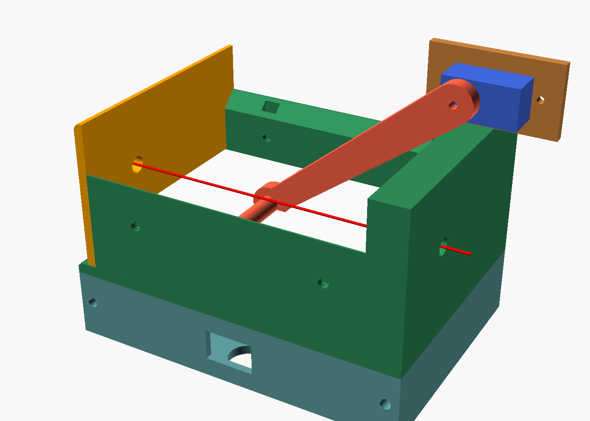

# Arduino Poker-Mischmaschine mit Austeil-Drehteller

Eine Maschine für Pokerabende. **Oben** mischt sie das Deck, **unten** teilt sie die
Karten aus. Dazu dreht sich die ganze Maschine auf einem Drehteller zu jedem Spieler
und schießt ihm die Karte zu. Gesteuert wird alles von einem Arduino Nano.


```
  SEITENANSICHT (vereinfacht)

   Schacht LINKS          Magazin          Schacht RECHTS
  ┌────────────┐┃                       ┃┌────────────┐
  │▓ Gewicht ▓ │┃       Servo-Arm ↻     ┃│ ▓ Gewicht ▓│      1) Mischen:
  │════════════│┃ ══►  ┌──────────┐ ◄══ ┃│════════════│         Karten fallen
  └────(O)─────┘       │  ↓    ↓  │       └────(O)─────┘         abwechselnd ins
  ┌────────────┐       │ ▬▬▬▬▬▬▬▬ │       ┌────────────┐         Magazin
  │  Unterbau  │       │ ════════ │═►     │  Unterbau  │      2) Austeilen:
  │            │       └───(O)────┘ Karte │ (Arduino)  │         Reibrad wirft die
  └────────────┴───────┴──────────┴───────┴────────────┘         unterste Karte
               ╔═══════ Drehlager ═══════╗                       nach vorne
               ║   Sockel mit NEMA 17    ║                    3) Drehen zum
               ╚═════════════════════════╝                       nächsten Spieler
```

---

## 1. Funktionsprinzip

### Mischen (oben)
1. Das Deck wird halbiert und in den **linken und rechten Schacht** gelegt. Ein
   Gewicht kommt obendrauf.
2. Unter jedem Schacht schiebt ein **Gummi-Reibrad** (N20-Motor) die unterste Karte
   durch einen schmalen **Spalt (Gate)**. Die Karte fällt in das **Magazin** in der Mitte.
3. Eine **IR-Lichtschranke** im Magazin erkennt jede fallende Karte. Der Motor stoppt
   sofort, und der Arduino entscheidet zufällig, welche Seite die nächste Karte abgibt.
   Das Verfahren ist das **Gilbert-Shannon-Reeds-Modell**, also das mathematische
   Modell eines echten Riffle-Shuffles: `P(links) = Karten_links / Karten_gesamt`.
4. Ist ein Schacht leer, kommen die restlichen Karten von der anderen Seite.

### Austeilen (unten)
5. Das Magazin ist gleichzeitig der **Dealer**. Ein **Servo-Arm** klappt herunter und
   drückt auf den Stapel.
6. Ein **schneller N20-Motor** mit Reibrad schießt die unterste Karte durch das
   Magazin-Gate **nach vorne** über den Tisch.
7. Ein **NEMA-17-Schrittmotor** im Sockel dreht die **ganze Maschine** (auf einem
   Lazy-Susan-Kugellager) zum nächsten Spieler, und so weiter.
8. Nach jeder Runde dreht sie zurück auf die Startposition, damit sich die Kabel nicht
   aufwickeln. Ein **TCRT5000**-Sensor im Magazinboden meldet, wenn das Magazin leer ist.

**Ein Knopfdruck** (Taster 1 lang) = mischen und sofort austeilen.

Mehrfach mischen (empfohlen: 3 Durchgänge): Taster 1 kurz drücken, Karten aus dem
Magazin nehmen, wieder teilen, in die Schächte legen. Beim letzten Durchgang Taster 1
**lang** drücken, dann wird danach direkt ausgeteilt.

---

## 2. Einkaufsliste

### Elektronik

| Anz. | Teil | Hinweis | ca. € |
|---:|---|---|---:|
| 1 | **Arduino Nano** (ATmega328P) | Ein Uno geht **nicht** (A6 wird gebraucht) | 5–20 |
| 2 | **TB6612FNG** Motortreiber-Breakout | #1 für die Mischmotoren, #2 für den Auswurf | 2× 4 |
| 2 | **N20-Getriebemotor 6 V, 150–300 U/min** | Mischschächte. D-Welle 3 mm × 10 mm | 2× 4 |
| 1 | **N20-Getriebemotor 6 V, 1000–1500 U/min** | Kartenauswurf (schnell!) | 4 |
| 1 | **NEMA-17-Schrittmotor** (z. B. 17HS4401, 40 mm) | Welle Ø5 mm mit Abflachung | 10–15 |
| 1 | **A4988** oder **TMC2208** (StepStick) | TMC2208 ist leiser | 3–6 |
| 1 | **SG90 Mikro-Servo** (oder MG90S mit Metallgetriebe) | Andruckarm | 3 |
| 1 | **IR-Lichtschranke 5 mm** (Sender + Empfänger, "IR break beam") | | 3–6 |
| 1 | **TCRT5000-Modul** (mit Komparator und Poti) | Sensor "Magazin leer" | 1 |
| 1 | **Netzteil 12 V / 2 A** mit 5,5 × 2,1-Stecker | | 8 |
| 1 | **Step-Down-Wandler 12 V → 5 V, ≥ 3 A** (z. B. MP1584, XL4015, LM2596) | versorgt Arduino, N20, Servo | 3 |
| 1 | DC-Einbaubuchse 5,5 × 2,1 + Kippschalter | | 2 |
| 2 | Taster 16 mm (Mischen, Austeilen) | | 2–4 |
| 1 | LED 5 mm + 220 Ω, passiver Buzzer | optional | 1 |
| 1 | Widerstand 10 kΩ | Pull-up für Taster 2 an A6 | – |
| 2 | Elko 470 µF / 16 V | an VM der TB6612 | 0,50 |
| 1 | Elko 100 µF / 25 V | an VMOT des A4988 (Pflicht!) | 0,30 |
| 3 | Keramikkondensator 100 nF | direkt an die N20-Motoren | – |
| – | Lochrasterplatine, Stiftleisten, Litze, **6-adriges flexibles Kabel** (ca. 40 cm) | | 5 |

### Mechanik

| Anz. | Teil | Hinweis |
|---:|---|---|
| 1 | **Lazy-Susan-Drehlager 150 mm (6 Zoll)**, Kugellager-Drehteller | trägt die ganze Maschine |
| 6 | **O-Ring 22 × 3 mm NBR** | 2 pro Reibrad |
| 1 | Holz-Rundstab Ø6 × 40 mm (z. B. Holzdübel), optional Silikonschlauch drüber | Druckrolle am Arm |
| 6 | M3 × 12 Senkkopf + 6 Muttern | Motorhalter → Böden |
| 6 | M3 × 10 Zylinderkopf + U-Scheibe | Gate-Platten |
| 4 | M3 × 25 Zylinderkopf + Mutter | untere Verbindung Unterbauten ↔ Magazin-Unterbau |
| 4 | M3 × 16 Zylinderkopf + Mutter | obere Verbindung Unterbauten ↔ Magazin |
| 4 | M3 × 8 Senkkopf | NEMA 17 → Sockeldeckel |
| 4 | M3 × 10 Senkkopf | Sockeldeckel → Sockel |
| 2 | M3 × 10 Senkkopf | Servohalter → Magazin |
| 4 | M3 × 6 Madenschraube | 3 × N20 im Halter, 1 × Nabe auf NEMA-Welle |
| 8 | Holzschrauben 3 × 12 | Lazy-Susan an Sockeldeckel und Unterbauten |
| ca. 200 g | Münzen oder M10-Muttern | Füllung der zwei Schacht-Gewichte |
| 4 | Gummifüße | unter den Sockel |

**Gesamtkosten:** ca. 90–120 € plus ca. 600 g Filament.

---

## 3. 3D-Druck-Teile

Alle Teile stehen im parametrischen OpenSCAD-Modell
[`cad/card_shuffler.scad`](cad/card_shuffler.scad). Fertige STLs liegen in
[`cad/stl/`](cad/stl/). Alle Teile passen auf einen Drucker mit 220 × 220 mm und
brauchen **keine Stützen**.

| Teil | STL | Anz. | Ausrichtung beim Druck |
|---|---|---:|---|
| Mischschacht | `tray.stl` | 2 | Boden unten |
| Gate-Platte Mischschacht | `gate.stl` | 2 | flach |
| Motorhalter N20 | `motor_bracket.stl` | **3** | stehend (wie exportiert) |
| Reibrad-Nabe | `wheel.stl` | **3** | flach |
| Schacht-Gewicht | `weight.stl` | 2 | Öffnung oben |
| Unterbau links | `side_box.stl` | 1 | Boden unten |
| Unterbau rechts (Elektronik, Taster) | `side_box_elec.stl` | 1 | Boden unten |
| **Magazin / Dealer** | `magazine.stl` | 1 | Boden unten |
| Gate-Platte Magazin (mit LED-Halter) | `mag_gate.stl` | 1 | flach, LED-Halter oben |
| Magazin-Unterbau mit Wellennabe | `mag_box.stl` | 1 | Boden unten |
| Servohalter | `servo_mount.stl` | 1 | Fuß unten |
| Andruckarm | `press_arm.stl` | 1 | flach |
| Sockel | `base.stl` | 1 | Boden unten (160 × 160 mm) |
| Sockeldeckel | `base_lid.stl` | 1 | flach |

**Druckeinstellungen (PLA oder PETG):**
- 0,2 mm Schichthöhe. Gate-Platten und Reibräder mit 0,12–0,16 mm drucken.
- 3 Wände, 20–25 % Infill. Sockeldeckel und Magazin-Unterbau mit **40 %** Infill, denn
  hier sitzen Motor und Welle.
- **Böden von Schächten und Magazin glätten** (Ironing). Noch besser:
  **PTFE-Klebeband** aufkleben, damit die Karten leicht gleiten.
- Die **Unterkanten der Gate-Platten** müssen gerade und gratfrei sein.

### Selbst exportieren / anpassen

```bash
cd cad
for p in tray gate motor_bracket wheel weight side_box side_box_elec \
         magazine mag_gate mag_box servo_mount press_arm base base_lid; do
  openscad -D "PART=\"$p\"" -o stl/$p.stl card_shuffler.scad
done
```

| Parameter | Standard | Bedeutung |
|---|---|---|
| `card_w`, `card_l` | 63,5 / 88,9 | Kartenformat (Bridge: `card_w = 57`) |
| `gate_gap` | 0,5 mm | Nenn-Spalt unter den Gates (wird per Langloch justiert) |
| `wheel_protr` | 1,0 mm | wie weit die Reibräder über den Boden ragen |
| `n20_a`, `n20_b` | 12,3 / 10,3 | Tunnel für N20. Mit Messschieber nachmessen! |
| `box_h` | 60 mm | Höhe der Mischer-Unterbauten |
| `mbox_h` | 22 mm | Höhe Magazin-Unterbau |
| `nema_shaft`, `nema_flat` | 5,1 / 4,6 | D-Bohrung der Nabe für die NEMA-Welle |
| `hub_top` | 19 mm | Höhe der Nabe (Wellenlänge beachten, siehe 6.) |
| `susan_h` | 8 mm | Bauhöhe des Lazy-Susan-Lagers |
| `arm_len` | 75 mm | Länge Andruckarm |

---

## 4. Wenn du lieber selbst in CAD konstruierst (Fusion 360, Onshape, FreeCAD)

Die kritischen Maße:

1. **Mischschacht:** Innenraum 66 × 92 mm. Reibrad Ø ca. 29 mm, ragt **1 mm** über den
   Boden, Kontaktpunkt **12 mm** vor dem Gate. Gate-Spalt = **1 Kartendicke + 0,1 mm**
   (ca. 0,4 mm), verstellbar über Langlöcher.
2. **Abbruchkante** des Schachts ca. **20 mm über dem vollen Stapel** im Magazin
   (hier: Kante bei 63,5 mm, Magazinboden bei 25,5 mm über dem Drehteller).
3. **Magazin:** Innenraum 68 (Mischrichtung) × 92 mm. Die Seitenwände sind niedrig und
   innen angefast, damit die Karten hineinrutschen. Das Gate liegt **vorne** (quer zur
   Mischrichtung), dort fliegen die Karten raus. Das Reibrad steht **14 mm** hinter dem
   Gate, die Achse liegt in Mischrichtung.
4. **Lichtschranke:** von vorn (im Magazin-Gate) nach hinten (Rückwand), **über** dem
   vollen Stapel und **unter** der Abbruchkante. Jede fallende Karte kreuzt sie, egal
   von welcher Seite sie kommt.
5. **Andruckarm:** Drehpunkt über der Rückwand. Beim Mischen steht er senkrecht nach
   oben (aus dem Fallbereich), beim Austeilen liegt er mit einer Rolle quer auf dem
   Stapel.
6. **Drehachse = Mitte des Magazins.** Das Lager hat 150 mm, damit die seitlich
   überstehenden Mischer stabil getragen werden.
7. Die Teile höchstens ca. 200 × 200 mm groß machen, sonst passen sie nicht auf gängige
   Drucker.

---

## 5. Verkabelung

### 5.1 Was wo sitzt

| Ort | Bauteile |
|---|---|
| **Sockel** (steht still) | DC-Buchse 12 V, Schalter, Step-Down 12→5 V, **A4988/TMC2208**, NEMA 17 |
| **Unterbau rechts** (dreht sich) | Arduino Nano, 2× TB6612, Taster 1 + 2, LED, Buzzer |
| **Drehende Teile** | 3× N20, Servo, Lichtschranke, TCRT5000 |

Zwischen Sockel und drehendem Teil laufen **4 Adern**: **+5 V, GND, STEP, DIR**. Sie
gehen als lockere Schlaufe (ca. 30 cm) durch die Löcher im Sockeldeckel und im
Magazin-Unterbau. Die Maschine dreht maximal ca. 330° und dann wieder zurück, die
Schlaufe reicht also.

### 5.2 Pinbelegung Arduino Nano

| Pin | Verbunden mit |
|---|---|
| D2 | Lichtschranke Empfänger **Signal** |
| D3 (PWM) | TB6612 **#2 PWMA** (Auswurf-Motor) |
| D4 | **STBY** von TB6612 #1 **und** #2 |
| D5 (PWM) | TB6612 #1 PWMA (Schacht links) |
| D7 / D8 | TB6612 #1 AIN1 / AIN2 |
| D6 (PWM) | TB6612 #1 PWMB (Schacht rechts) |
| D9 / D10 | TB6612 #1 BIN1 / BIN2 |
| D11 | **Servo** Signal (orange) |
| D12 | **Taster 1** (Mischen) → GND |
| D13 | LED (+220 Ω) |
| A0 | **frei lassen!** (Zufallsrauschen) |
| A1 | TB6612 **#2 AIN2** (AIN1 von #2 fest an 5 V) |
| A2 | A4988 **STEP** |
| A3 | A4988 **DIR** |
| A4 | Buzzer (optional) |
| A5 | TCRT5000 **DO** |
| A6 | **Taster 2** (Austeilen) → GND, **plus 10 kΩ von A6 nach 5 V** |
| 5V / GND | alle Module (VCC), Servo (rot/braun), Lichtschranke |

### 5.3 Schaltplan

```
 12V ─[DC-Buchse]─[Schalter]─┬──────────────► A4988 VMOT (+100µF Elko direkt dran!)
                             │
                             └─[Step-Down 12→5V, 3A]─┬─► +5V-Schiene ──► (Schlaufe) ──► drehender Teil
 GND ────────────────────────────────────────────────┴─► GND-Schiene ──► (Schlaufe) ──► drehender Teil

 A4988 / TMC2208 (im Sockel)              drehender Teil (Unterbau rechts)
 ┌──────────────┐                          ┌─────────────┐
 │ STEP ◄───────┼──── (Schlaufe) ──────────┤ A2   Nano   │
 │ DIR  ◄───────┼──── (Schlaufe) ──────────┤ A3          │
 │ EN  ─ GND    │                          │             │
 │ MS1/2/3: 16tel-Schritt (A4988: alle HIGH)│             │
 │ 1A1B2A2B ──► NEMA 17                    └─────────────┘
 │ VDD ◄─ 5V, GND                          
 └──────────────┘

 TB6612 #1:  VM, VCC ◄─ 5V   AO1/AO2 ─► N20 links    BO1/BO2 ─► N20 rechts
 TB6612 #2:  VM, VCC, AIN1 ◄─ 5V   AO1/AO2 ─► N20 schnell (Auswurf)
 Je 470 µF an VM der TB6612.
```

**Wichtig:**
- Den **Motorstrom am A4988/TMC2208** mit dem Poti einstellen (ca. 0,8–1 A für
  17HS4401). Anleitung zum Treiber beachten. Den Motor **niemals** bei laufender
  Spannung ab- oder anstecken.
- Arduino mit 5 V an den **5V-Pin** versorgen, nicht an VIN.
- Läuft ein N20 falsch herum, tauschst du seine zwei Kabel.

---

## 6. Zusammenbau

**Sockel**
1. NEMA 17 von unten an den **Sockeldeckel** schrauben (4 × M3 × 8 Senkkopf von oben).
   Die Welle zeigt nach oben.
2. Step-Down-Wandler auf 5,0 V einstellen (**vor** dem Anschließen messen!). Danach
   Treiber, Buchse und Schalter im **Sockel** einbauen.
3. Deckel auf den Sockel schrauben. Das **Lazy-Susan-Lager** mittig auf den Deckel
   schrauben (Holzschrauben 3 × 12).
4. **Wellenlänge prüfen:** Die Welle darf höchstens **ca. 25 mm** über den Deckel
   ragen (Lager 8 mm + Nabe 19 mm − Luft). Ist sie länger, unter den Motorflansch
   Unterlegscheiben legen.

**Drehender Teil**
5. In alle Motorhalter Muttern einsetzen, die **N20-Motoren** einschieben und mit
   Madenschrauben klemmen. Die Reibräder (mit O-Ringen) auf die Wellen pressen.
6. **Mischschächte:** Motorhalter mit 2 × M3 × 12 Senkkopf von oben durch den Boden
   schrauben, Gate-Platten locker anschrauben.
7. **Magazin:** den Motorhalter mit dem **schnellen** N20 unter den Boden schrauben (er
   liegt quer). Den **TCRT5000** von unten ins rechteckige Fenster kleben (Sensor ca.
   0,5 mm unter der Bodenoberseite). Den IR-**Empfänger** in die Bohrung der Rückwand,
   den IR-**Sender** in den Halter der Magazin-Gate-Platte. Gate-Platte vorne locker
   anschrauben.
8. **Servo** in den Servohalter schrauben und den Halter mit 2 × M3 auf die Rückwand.
   Das einarmige Servohorn in die Tasche des Andruckarms legen und verschrauben, dann
   den Rundstab Ø6 einkleben. Den Arm **erst nach dem Servotest** (Abschnitt 8)
   endgültig aufstecken.
9. Muttern von oben in die Schlitze von **Magazin-Unterbau** und **Magazin** schieben.
10. Unterbau links, Magazin-Unterbau und Unterbau rechts (um 180° gedreht) nebeneinander
    stellen und **unten** mit 2 × 2 M3 × 25 verschrauben.
11. Magazin auf den Magazin-Unterbau setzen (Zentrierstifte) und **oben** mit 2 × 2
    M3 × 16 durch die Unterbauten verschrauben.
12. Elektronik im rechten Unterbau einbauen, Taster und LED in die Löcher, Kabel durch
    die Durchführungen ziehen.
13. Die drehende Einheit mit der **Nabe** auf die NEMA-Welle setzen. Die Abflachung zeigt
    zur Madenschraube. Dann mit dem Lazy-Susan-Lager verschrauben (Holzschrauben von
    unten durch die Lagerplatte in die Böden der drei Unterbauten). Die Madenschraube
    der Nabe festziehen.
14. **Startposition:** Das Magazin-Gate (Auswurf) zeigt auf die **Kerbe vorne am
    Sockel**. Die Kerbe zeigt auf Spieler 1.
15. Schächte auf die Unterbauten setzen, Gewichte füllen, Gummifüße unter den Sockel.

---

## 7. Software aufspielen

1. [Arduino IDE](https://www.arduino.cc/en/software) installieren.
2. `firmware/CardShuffler/CardShuffler.ino` öffnen.
3. **Board:** "Arduino Nano", **Prozessor:** "ATmega328P" bzw. bei Klonen
   **"ATmega328P (Old Bootloader)"**.
4. Hochladen. Es werden nur die mitgelieferten Bibliotheken **Servo** und **EEPROM**
   verwendet, du musst nichts installieren.
5. Seriellen Monitor öffnen: **115200 Baud**.

### Serielle Befehle

| Befehl | Funktion |
|---|---|
| `m` | Motortest der beiden Mischmotoren |
| `t` | Lichtschranken-Test (5 s, Karten durchfallen lassen) |
| `l` / `r` | eine Karte links / rechts ins Magazin |
| `s` | einen Mischdurchgang starten (`x` = Abbruch) |
| `w` | Drehtest: eine Umdrehung hin und zurück |
| `e` | eine Karte aus dem Magazin werfen |
| `z` | Magazin-Sensor abfragen |
| `v90` | Servo auf 90° fahren (zum Einstellen des Arms) |
| `u` | Arm hoch |
| `c52` | Kartenzahl im Magazin setzen (für den Arm-Winkel) |
| `p6` / `k2` | 6 Spieler / 2 Karten pro Spieler (bleibt gespeichert) |
| `d` | austeilen |
| `a` | mischen und austeilen |
| `0` | Durchgangszähler zurücksetzen |
| `h` | Hilfe |

---

## 8. Inbetriebnahme und Kalibrierung

1. **Servo-Arm einstellen:**
   - `v10` eingeben: Der Arm muss **senkrecht nach oben** stehen. Den Wert in
     `ARM_UP_DEG` eintragen.
   - 52 Karten ins Magazin legen und den Winkel mit `v100`, `v110`, `v120` … suchen,
     bei dem die Rolle **gerade aufliegt**. Den Wert in `ARM_FULL_DEG` eintragen.
   - Das Gleiche mit leerem Magazin (Rolle auf dem Boden): `ARM_EMPTY_DEG`.
   - `ARM_PRESS_DEG` (Standard 5°) bestimmt den Andruck.
2. **Mischmotoren (`m`):** "vorwärts" muss die Karte Richtung Magazin schieben. Sonst
   `INVERT_LEFT`/`INVERT_RIGHT` ändern oder die Kabel tauschen.
3. **Lichtschranke (`t`):** Jede fallende Karte muss genau einmal gezählt werden. Am Ende
   muss "Strahl frei - OK" erscheinen. Der Arm muss oben sein (`u`).
4. **Gates einstellen:** Schrauben lösen, **eine Karte** unter die Gate-Kante legen,
   Gate daraufdrücken, festschrauben, Karte rausziehen. Mit `l`, `r` und `e` testen.
   - 2 Karten auf einmal → Spalt kleiner.
   - keine Karte / Stau → Spalt größer.
   - Ein Streifen Kreppband an der Gate-Unterkante (Innenseite) hilft gegen Doppelte.
5. **Drehteller (`w`):** genau eine Umdrehung? Sonst `STEPS_PER_REV` prüfen
   (200 × Mikroschritte). Falsche Richtung: `STEP_REVERSE = true`.
6. **Wurf (`e`):** Wurfweite über `DEAL_POWER` einstellen, Laufzeit über
   `DEAL_PULSE_MS`. Kommen 2 Karten, `DEAL_PULSE_MS` verkleinern. Bleibt die Karte
   hängen, vergrößern.
7. **Magazin-Sensor (`z`):** mit dem blauen Poti am TCRT5000 so einstellen, dass er
   "Karte" meldet, sobald eine einzelne Karte über dem Fenster liegt.

### Wichtige Konstanten im Code

| Konstante | Standard | Bedeutung |
|---|---|---|
| `DECK_SIZE` | 52 | Kartenanzahl (mit Jokern 54) |
| `FEED_SPEED` | 170 | Geschwindigkeit der Mischmotoren (PWM 0–255) |
| `MAX_SAME_SIDE` | 5 | max. Karten am Stück von einer Seite (0 = reines Zufallsmodell) |
| `DEAL_POWER` / `DEAL_PULSE_MS` | 255 / 70 | Wurfkraft / Laufzeit pro Karte |
| `DEAL_ARC_DEG` | 360 | 360 = Spieler rundherum, 180 = Halbkreis |
| `STEPS_PER_REV` | 3200 | NEMA 17 mit 16tel-Schritt |
| `STEP_US_FAST` / `RAMP_STEPS` | 150 / 800 | Drehgeschwindigkeit / sanftes Anfahren |
| `ARM_UP_DEG` / `ARM_FULL_DEG` / `ARM_EMPTY_DEG` | 10 / 120 / 150 | Servo-Winkel |

---

## 9. Bedienung

| Aktion | Wirkung |
|---|---|
| **Taster 1 kurz** | ein Mischdurchgang (Karten landen im Magazin) |
| **Taster 1 lang (> 1,5 s)** | **mischen und direkt austeilen** |
| **Taster 2 kurz** | Spielerzahl +1 (2–10). Die LED blinkt die Anzahl |
| **Taster 2 lang (> 1 s)** | austeilen (Karten liegen schon im Magazin) |
| Taster 1 während Mischen oder Austeilen | Abbruch. Die Maschine fährt zurück zur Startposition |

**Typischer Ablauf:**
1. Deck halbieren, beide Hälften mit der **Bildseite nach unten** in die Schächte legen,
   Gewichte drauf.
2. Taster 1 **kurz**: 1. Durchgang. Karten aus dem Magazin nehmen, halbieren, einlegen.
3. Das Gleiche noch einmal (2. Durchgang).
4. Taster 1 **lang**: 3. Durchgang, danach wird automatisch ausgeteilt.
5. Die restlichen Karten (Flop/Turn/River) nimmst du aus dem Magazin.

**Signale:** Kurzes Aufblitzen alle 3 s = bereit. LED dauerhaft an = Maschine arbeitet.
3 tiefe Pieptöne = Stau oder Magazin leer.

---

## 10. Fehlersuche

| Problem | Lösung |
|---|---|
| Reibrad dreht durch | mehr Gewicht bzw. `ARM_PRESS_DEG` erhöhen; O-Ringe mit Alkohol reinigen |
| Zwei Karten gleichzeitig | Gate-Spalt verkleinern; Kreppband an der Gate-Kante |
| Karten landen schief im Magazin | `FEED_SPEED` reduzieren; Seitenwand-Fasen glätten |
| Karte fliegt nicht weit genug | `DEAL_POWER` / `DEAL_PULSE_MS` erhöhen; schnelleren N20 nehmen |
| Drehteller verliert Schritte | Motorstrom am Treiber erhöhen; `STEP_US_FAST` vergrößern; `RAMP_STEPS` erhöhen |
| Arduino startet neu, wenn Motoren anlaufen | Step-Down zu schwach (≥ 3 A); Elkos an VM; 100 nF an den Motoren |
| Servo zittert | Servo-Strom kommt vom Step-Down, nicht vom Nano-5V-Regler; 470 µF an die Servo-Versorgung |
| Zählung ≠ 52 | Lichtschranke ausrichten (`t`); Arm muss oben sein |
| Upload schlägt fehl | Prozessor "ATmega328P (Old Bootloader)"; CH340-Treiber installieren |

---

## 11. Projektstruktur

```
.
├── README.md                       ← diese Anleitung
├── firmware/CardShuffler/
│   └── CardShuffler.ino            ← Arduino-Code (Mischen + Austeilen)
├── cad/
│   ├── card_shuffler.scad          ← parametrisches CAD-Modell (OpenSCAD)
│   └── stl/                        ← fertige Druckdateien
└── docs/                           ← Vorschaubilder
```


